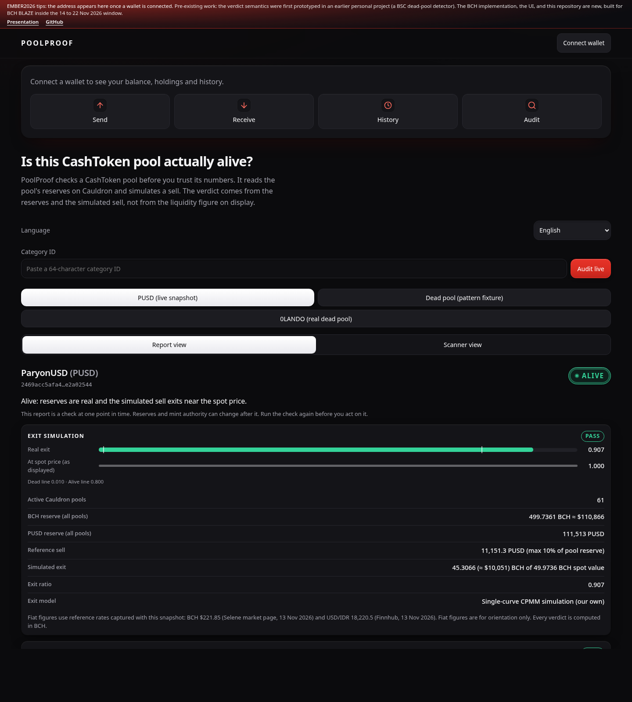
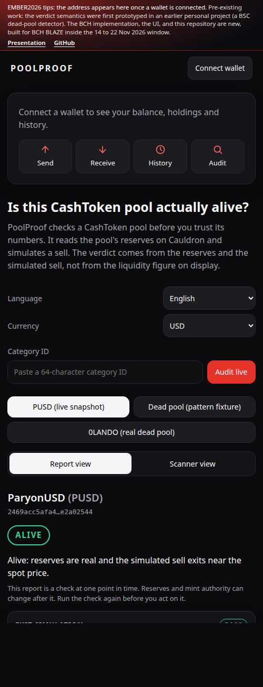

# PoolProof BCH

PoolProof tells you whether a CashToken pool can actually pay you out. It reads real Cauldron reserves, simulates the full exit, cross-checks the venue's own router, and anchors the report hash in a Bitcoin Cash mainnet transaction.

**Live demo: https://hanafynst.github.io/poolproof-bch/**

No login and no wallet are needed to read a report. A wallet is only needed for the anchor step at the end.

## The problem

A liquidity figure on a token page is a display value. The reserves behind it can be dust, and a buyer who trusts the display can enter a position they cannot exit. PoolProof answers the question that matters before a buy: if you had to sell, what would you actually get?

## What it does

Paste a CashToken category ID and PoolProof builds a report with one of five verdicts:

| Verdict | What it means |
| --- | --- |
| NO_MARKET | No Cauldron pool trades this token against BCH. |
| DEAD | Reserves sit at dust level, under 100,000 sats. There is nothing real to sell into. |
| LYING_DISPLAY | Real liquidity is under 1% of the figure on display. |
| RISKY | The simulated exit pays far less than the spot price suggests. |
| ALIVE | Reserves are real and the simulated exit pays near spot. |

The decision number is the simulated exit, not the spot price. The reference sell is routed across every one of the token's Cauldron pools in chunks, each pool repricing as the sell moves through it and each pool charging its 0.3% LP fee, the same path the venue's router would have to take. All money math is bigint satoshi math. The report names the simulation model behind every figure, carries a checked-at time and its data sources, and states plainly that reserves can change after the check.

The report also includes:

- **Concentration.** Holder distribution for the category, pinned by exact category ID from a second source: top-holder share, Gini coefficient and HHI, so a pool that one wallet can crush is visible before you buy. A genesis sentinel supply is flagged as a sentinel and never divided into.
- **Identity and supply cross-check.** Token identity, supply and mint authority come from TokenStork, independent of the Cauldron indexer that supplies the reserves.
- **Honest negative states.** A category ID that matches nothing on chain gets a "Category not found" answer naming the sources that were checked. It never gets dressed up as a verdict.
- **Proof anchor.** The finished report's SHA-256 hash is written into an OP_RETURN output of a Bitcoin Cash mainnet transaction, signed in your own wallet through WizardConnect. At the default fee rate of 1 sat per byte the anchor costs 235 sats. Anyone can re-hash the report and match the hash against the chain.
- **Report files.** Download the report as JSON, or share it as a link (`?cat=` for a live category, `?snap=` for a bundled snapshot).
- **Wallet home.** The app opens on the Wallet room: balance, Send, Receive and History in one screen, and the Audit tile switches to the Check room, where the reports live. The bundled PUSD verdict is one tap away in Check, and a shared report link (`?cat=` or `?snap=`) lands on its report directly. Send has an asset picker covering BCH, CashTokens and NFTs, address-type detection that blocks token sends to plain addresses, a confirmation sheet with a fee preview (priced in dollars at the live rate when one is available), and receipts whose confirmation status updates in History. Below the wallet card, the portfolio card totals the connected wallet in USD: a composition ring, one row per asset with its share of the priced total, token values at Cauldron pool spot prices, and holdings with no usable pool listed with their amounts and no value.
- **Eight languages.** English by default, plus Bahasa Indonesia, Mandarin (Simplified), Español, हिन्दी, العربية (right-to-left), Português and Français. Numbers render in Latin digits in every language. Fiat is USD only: the portfolio card and the Send fee preview price it at a live BCH/USD rate whose source the app names, and show no dollar figures when no source answers; bundled snapshot reports carry the rates captured with the snapshot, labelled as such. Verdicts are always computed in BCH and satoshis.

Three bundled snapshots (ParyonUSD, a dead-pool pattern fixture and 0LANDO, a real dead pool) let you read a full report without typing a category ID.

## Screenshots

Desktop at 1440px, the ParyonUSD (PUSD) snapshot report open with an ALIVE verdict:



The same home at phone width, with the event banner on top and the wallet actions in one row of four:



## How it works

PoolProof is a static Vite, React and TypeScript site. There is no server and no account system; GitHub Pages hosts the build and every read happens from the browser.

- **Reserves** come from the Cauldron Indexer run by Riften. **Identity, supply, mint authority and holders** come from TokenStork as an independent second source. **Wallet balance and confirmation status** come from public Electrum servers over WebSocket. **The BCH/USD rate** comes from public price endpoints, Kraken first, then Coinbase, then CoinGecko; the first valid quote wins, and when none answer the app shows no dollar figures rather than a stale rate.
- The verdict core is pure TypeScript. It reads per-pool reserves, runs the routed constant-product simulation and applies the verdict thresholds. Nothing in the money path uses floating point.
- **Wallet pairing and signing** use WizardConnect, which connects the app to Paytaca, Selene or Cashonize. Pairing follows the routes those wallets actually use: with the wallet on the same phone, copy the connection link in the dialog and paste it into the wallet's connect or scan page; with the wallet on a second device, scan the dialog's QR code. The dialog also offers a deep-link button for wallets that answer one. The wallet signs; the app checks the signed bytes against the transaction you confirmed before broadcasting through Electrum. Transaction building uses `@bitauth/libauth`.
- **If pairing stalls.** Keep exactly one tab of the demo open; two tabs share one stored session and fight over it. After scanning or pasting in the wallet, return to the demo tab right away and keep it in front: the wallet's answer goes stale within seconds, and it can only land while the tab is in front. If the wallet already shows PoolProof as connected but the page does not, the wallet is holding a stale connection. Remove the old PoolProof entries in the wallet's Wizard Connect list (in Paytaca: Apps, then Wizard Connect), then pair again. If the header sits at "Waiting for wallet..." after a reload, the Cancel beside it clears the stored session so a fresh pairing can start.
- The app holds no keys and never takes custody of funds. Your wallet keeps your keys, and every transaction is shown to you before it is offered to the wallet for signing.

## Run locally

```sh
npm install
npm run dev
npm run build
```

`npm run dev` serves the app locally. `npm run build` type-checks the project and writes the production site to `dist/`.

## Testing

The verdict and wallet logic was built in a practice lab first, then ported into this repository file by file. The shipped core modules are byte-identical to the lab copies the suite runs against, with one exception: `src/core/wallet-address.ts` adds a token-aware address form (the address the banner and the Receive panel show) on top of its lab copy, built from the same payload code. The lab suite currently runs **687 checks, all passing**, covering:

- verdict thresholds and the routed exit simulation, tested against real captured fixtures (PUSD alive, 0LANDO dead);
- the exit gauge's model (ratio and dust-reserve modes, with the tick positions taken from the verdict's own constants), the per-pool reserve split, and the audit's stage signals, which fire only when their real read resolves;
- concentration math, including Gini tiers, HHI and the sentinel-supply guard;
- the anchor transaction: fee model, and funding selection that never spends a token or NFT UTXO to pay a fee;
- the send flow's confirmation gate, address-type blocking and amount keypad;
- history storage, versioned migration and forward-only confirmation status;
- the transaction feedback queue: per-transaction dedupe, failure-sparing eviction, dwell and announcement rules, the broadcast-to-confirmed flip detector, and the receive rule that can never mistake the wallet's own change for an incoming payment;
- the lookup classification that separates a real token with no market from a category that does not exist.

The suite runs locally. There is no CI badge here because there is no CI claim to back one.

## BCH BLAZE 2026

Built solo by Hanafi (@hannn) from Indonesia for [BCH BLAZE 2026](https://dorahacks.io/hackathon/bchblaze2026/detail) on DoraHacks, Mainnet Track. This repository was created on 14 November 2026, inside the event's 14 to 22 November 2026 build window.

Pre-existing work disclosure, the same wording as the banner at the top of the demo: the verdict semantics were first prototyped in an earlier personal project, a dead-pool detector that was never released. The BCH implementation, the UI, and this repository are new, built for BCH BLAZE inside the 14 to 22 Nov 2026 window.

## License

MIT
